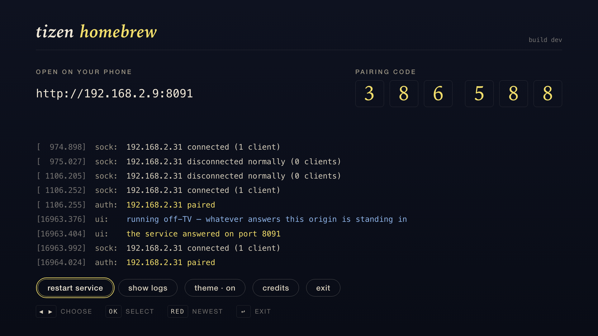
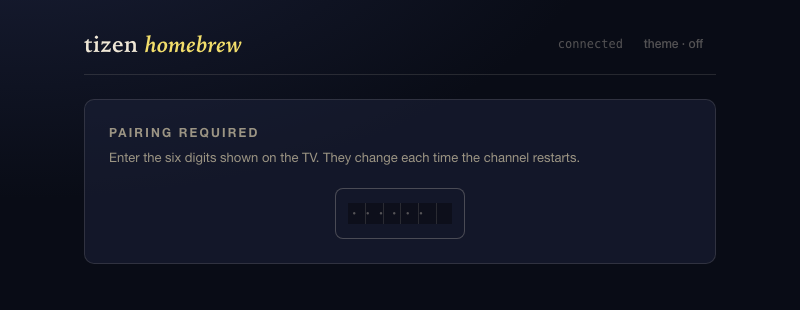

# Tizen Homebrew

Install apps on a Samsung TV from your phone — or from an agent.


Developer Mode normally points a TV at a computer that has to stay on the
network. This points it at `127.0.0.1` — the TV becomes its own developer
machine — and the whole surface is plain JSON over the network, so anything
that can `curl` can drive it. Set it up once; no computer after that.

- Install from a catalog, a GitHub release, a URL, or a USB stick
- Re-signs every package for your TV, so builds signed by other people install
- A dmesg-style log on the TV screen
- An sdb shell, from the phone
- An agent-friendly contract: [AGENTS.md](AGENTS.md) is the complete
  operational reference for an LLM (or a script) driving the TV — install,
  wake, restart, logs, remote keys

**Discord**: https://discord.gg/WjxVnrsV4A

<table>
<tr>
<td></td>
</tr>
<tr>
<td align="center"><sub>The address, the code, and whatever the service is doing. The yellow ring is where the remote is.</sub></td>
</tr>
</table>

---

## Install

One command. It carries its own runtime, so nothing has to be installed first.

### Linux/MacOS
```sh
curl -fsSL https://lvndry.github.io/tizen-homebrew/install.sh | sh
```

### Windows
```powershell
irm https://lvndry.github.io/tizen-homebrew/install.ps1 | iex
```

It tells you what to switch on, finds the TV, mints a Samsung certificate
against your own account, installs the app, and tells you what to switch back.
Ten minutes, most of it spent restarting the TV.

Two steps are yours: sdbd runs a command allowlist, so no software can do them.
Both are **Apps** → **12345** (or hold Enter) → **Settings**, and both need a
restart, since that value is only read at startup.

| When | Set **Host PC IP** to |
| --- | --- |
| Before installing | this computer's address — the installer prints it |
| After installing | `127.0.0.1` |

The second makes the rest work: the TV then installs its own apps, and no other
machine can reach its sdb daemon.

**From a checkout**, with Node 20+:

```sh
git clone https://github.com/lvndry/tizen-homebrew.git
cd tizen-homebrew
npm install
npm run full-bootstrap          # or: -- <tv-ip>, if you know it
```

---

## Using it

| Tab | |
| --- | --- |
| **Apps** | The catalog, installed with one press |
| **Upload** | A `.wgt` from the phone |
| **GitHub** | `owner/repo` — takes the newest release |
| **URL** | A direct https link |
| **USB** | A stick plugged into the TV |
| **Shell** | sdb commands, off by default |

The PIN changes every time the app opens, and the TV screen shows the current
one. Your phone keeps the last one that worked until the TV restarts.

<table>
<tr>
<td></td>
</tr>
<tr>
<td align="center"><sub>The phone, before it has been told the six digits</sub></td>
</tr>
</table>

**Updates.** Every **Apps** row says whether it is installed and at which
version. Whether anything newer was *released* is a GitHub request per app, so
it waits to be asked: **check** on a row, or **check all** under the list.
Tizen Homebrew is in its own catalog, so it updates itself the same way.

---

## From an agent

The service is a small HTTP API and the TV a set of keys, so an LLM with
shell access can do everything a human does — and [AGENTS.md](AGENTS.md) is
written exactly for that: the endpoints, the toolbox commands, and the honest
failure modes (what `:8091 = 000` means, why silence from the TV is often a
working result, the agent's contract: never power the TV off).

```sh
curl -H "x-homebrew-pin: 000000" http://<tv>:8091/packages   # what's on it
node remote.js home ok up down                              # move the cursor
curl -X POST --data-binary @app.wgt http://<tv>:8091/install   # put something on
```

The companion [samsung-tv-toolbox](https://github.com/lvndry/samsung-tv-toolbox)
is the plain-Node side: pairing, remote keys, Wake-on-LAN, service restart.

---

## How it works

**Re-signing.** A Tizen package names the device it may be installed on, in its
distributor certificate:

    URI:URN:tizen:deviceid=CPCLIM2YRW7DO

From Tizen 7 the TV enforces it, so a `.wgt` installs on its builder's set and
nowhere else. Prebuilt widgets therefore cannot be handed around, and the TV is
given its own pair during setup: a set holding one re-signs everything it
installs, in about 150ms.

**Always on.** `config.xml` declares the service `on-boot` and `auto-restart`,
so it comes up with the television — switch the set on, load the address on a
phone, install. The app remains for the log, the pairing code and a restart
button, and closing it leaves the service running. `POST /restart` self-heals
in a few seconds: on this firmware the platform only relaunches a service that
died *abnormally*, so a restart dies by throwing, and a clean exit stays down.

**Security.** The install endpoint is deliberately open to the network, gated
by the 6-digit PIN: minted on first run, readable only over loopback so a
person has to relay it. Five wrong guesses locks pairing for five minutes. The
sdb relay is off by default, takes a second opt-in to survive reboots, and
refuses commands that would disable it or uninstall the app.

**The log.** sdbd's allowlist excludes every log tool, so the app carries its
own. Press **show logs** on the TV; up/down a line, left/right a page, RED for
newest. `GET /logs?since=<seq>` returns the same records as JSON.

```
[    0.906] sdb: loopback 127.0.0.1:26101 answered — this TV can install its own apps
[   59.220] pkg: installed Tube 0.1.0 in 7.22s
```

**The catalog.** The app list is [`catalog/`](catalog/), published to GitHub
Pages. Adding an app is a commit there — no rebuild, nothing to reinstall.

---

## Working on it

```sh
npm run dev          # both screens in a browser, no hardware needed
npm run dev:service  # the service off-TV, on :8091
npm test             # lint, typecheck, protocol, PIN gate, install pipeline
```

`npm run dev` serves the TV at `/tv.html`, the phone at `/index.html`, both at
`/preview.html`. With no TV around `ui/dev/service.js` answers, real protocol
over a real WebSocket; `HOMEBREW_TV=<tv-ip> npm run dev` points it at hardware.

The installer is a separate program in [`installer/`](installer/): Bun and
OpenTUI, compiled to one binary per platform. It calls `tools/` and `service/`
directly rather than reimplementing them, so the sdb client and the re-signer
have one implementation each.

| Path | |
| --- | --- |
| `ui/src/views/television.ts` | The TV screen: readouts, log console, credits |
| `ui/src/views/screens.ts` | The phone UI |
| `service/src/main.ts` | Composition root; routes live in `service/src/routes/` |
| `service/src/install/pipeline.ts` | Install, six named steps |
| `service/src/install/resign.ts` | Re-signing for this television |
| `service/src/tv/sdb.ts` | Loopback sdb with real timeouts |
| `service/src/obs/log.ts` | The log everything else writes to |
| `installer/src/work.ts` | The installer's steps, calling the above |

The build enforces two platform floors that are easy to trip: pages against
Chromium 63, which drops CSS it cannot parse *silently*, and the service bundle
against Node 12.

---

## Releasing

Pushing a tag builds the widget and the installer binaries and opens a draft
release with them attached. Tag and version have to agree:

```sh
npm run version:set 1.2.0    # and commit
git tag v1.2.0 && git push fork v1.2.0
```

The widget is **unsigned** — a signature names one television, and every Tizen
Homebrew re-signs what it installs anyway, including itself.

---

Licensed GPL-3.0-only. Built on the work in the credits screen — the Homebrew
Channel, TizenBrew, TizenTube, and the people who worked out what a Samsung TV
will and will not allow.
